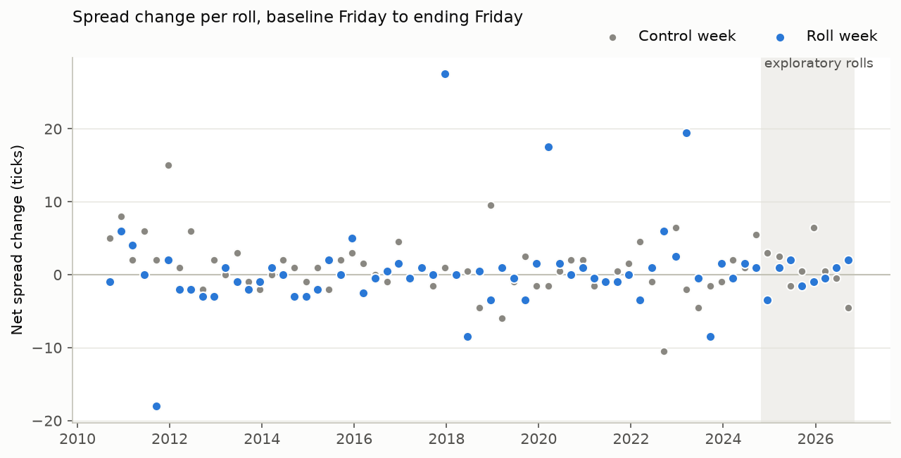

# Euro FX Futures Roll Pressure
FINM 37000 — Futures and Related Derivatives

**Do Euro FX calendar spreads move more in quarterly roll weeks than in comparable normal weeks?**

H1: the spread moves more in roll weeks than in control weeks. H2: it moves
in a consistent direction.

## Result

We found **no evidence of a roll-week effect**. On the 57 held-out rolls
(September 2010 to September 2024), the spread moved slightly more in roll
weeks than in control weeks, but the difference is well within noise.

| Test (57 rolls, ticks) | Estimate | 95% interval | p (sign / Wilcoxon) |
|---|---|---|---|
| H1: \|roll move\| − \|control move\|, mean per roll | +0.52 | −0.96 to +2.19 | 0.89 / 0.37 |
| H2: roll weeks where the spread rose | 24 of 50 | | 0.89 |
| H2: roll move − control move, mean | −0.45 | −2.30 to +1.64 | |

Mean absolute net move: 3.22 ticks in roll weeks, 2.70 in control weeks. One
tick is USD 6.25 per contract. H3, the dollar cost of rolling, is not
computed because H1 and H2 do not hold.



The result survives every sensitivity check in the plan: dropping rolls with
wide quotes (34 rolls), dropping rolls with a Fed or ECB decision in either
window (27 rolls), and two carry adjustments using observed USD and EUR
rates. The 8 recent rolls, where the idea came from, are exploratory and
show no increase either (−0.88, interval −2.44 to +0.38). Full output,
with block bootstrap intervals, is in
[outputs/stats.csv](outputs/stats.csv).

**This is weaker than "no effect".** The control week sits about five weeks
before expiry, where the deferred contract trades 1 to 2% of its roll-week
volume and is quoted about twice as wide. That makes control moves noisier
and biases the test toward finding nothing. In simulation
([outputs/power.csv](outputs/power.csv)), a roll-week move 1.5 times the
control's is detected only 29 to 43% of the time, and a move twice as large
68 to 85%.

## What else we found

- **Rolling is concentrated.** In the 8 recent rolls, 80 to 87% of the listed
  calendar spread's volume trades in the roll week and 0 to 1% in the control
  week ([notebooks/roll_spread_volume.ipynb](notebooks/roll_spread_volume.ipynb)).
  Outright volume crosses over later, 3 days before expiry in 63 of 65
  rolls, about two days after spread trading peaks.
- **Central-bank meetings line up with rolls.** A Fed or ECB decision falls
  inside 29 of 57 roll windows but only 1 control window
  ([outputs/meetings.csv](outputs/meetings.csv)), so they cannot be ignored.
  The no-meetings check above handles this.
- **Expiries.** The rule "two business days before the third Wednesday"
  matches Databento's contract definitions for 64 of 65 contracts. The
  exception, June 2023, expired a day early for Juneteenth, which the roll
  calendar now handles.
- **Data quality.** Across all 65 rolls only 7 snapshot days were dropped:
  5 CME holidays and 2 days in June 2014 with no quotes
  ([outputs/dropped_days.csv](outputs/dropped_days.csv)). That is far below
  the plan's 20% threshold for falling back to a shorter sample.

## Method

Each roll is a front and deferred contract pair. The spread is the deferred
midpoint minus the front midpoint, in ticks, from the best bid and offer at
10:00 America/Chicago ([Databento](docs/DATABENTO_REFERENCE.md) `bbo-1m`
data). The roll window is the last full Monday to Friday week before the
front contract expires; the control window is the same pattern four weeks
earlier. Each window's net change runs from the preceding Friday's snapshot
to its ending Friday's. The test statistic is one number per roll, and the
unit of analysis is the roll, not the minute.

The full list of decisions (quote-age limit, holidays, missing data,
bootstrap method, held-out split) is in
[docs/ANALYSIS_PLAN.md](docs/ANALYSIS_PLAN.md), with every change after the
results logged at the bottom. **We ran the main test before the plan was
signed off by all four members and before tagging it**, to meet the
deadline; the deviation log records this.

## Limits

- Calendar spreads mostly reflect the USD–EUR interest-rate gap, and we
  cannot show who pays for rolling or that rolling caused any move.
- Two checks were added after the plan and are labelled as such: control
  weeks 2 and 3 weeks out, and the power simulation. At 2 weeks H1 is +0.12
  (−1.31 to +1.68). At 3 weeks it is +1.17: the percentile interval includes
  zero (−0.21 to +2.78) while the block bootstrap interval just excludes it
  (+0.04 to +2.46), so we treat that check as inconclusive.
- A reversal check before expiry, other currencies, and CFTC positioning were
  cut for time.

## Reproduce

```bash
git clone https://github.com/chris-mulligan-50/futures-project.git
cd futures-project
python -m venv .venv && source .venv/bin/activate   # Windows: .venv\Scripts\activate
pip install -r requirements.txt
export DATABENTO_API_KEY="your-key"                 # never commit it
```

```bash
PYTHONPATH=src python -m euro_roll.analyze --all             # cost preview only
PYTHONPATH=src python -m euro_roll.analyze --all --download  # runs the test, writes outputs/
PYTHONPATH=src python -m euro_roll.power                     # reads outputs/, no download
python -m pytest                                             # no key or network needed
```

On Windows PowerShell, set the key and the path once, then drop the
`PYTHONPATH=src` prefix from the commands:

```powershell
$env:DATABENTO_API_KEY="your-key"
$env:PYTHONPATH="src"
python -m euro_roll.analyze --all
```

Other results cited above:

```bash
PYTHONPATH=src python -m euro_roll.analyze --all --download --control-offset 2  # also 3
PYTHONPATH=src python -m euro_roll.liquidity --all --download  # control_liquidity.csv
PYTHONPATH=src python -m euro_roll.volume_share                # outright volume crossover
```

The first download takes about 45 minutes. Requests are cached under
`data/databento/` (git-ignored), so repeating one is free. Databento quotes
differ by account, so check the preview before downloading.

## Repository

```
src/euro_roll/   download, cache, expiries, windows, spread, changes, stats,
                 meetings, carry, rates, liquidity, analyze, power
tests/           synthetic-data tests; GitHub Actions runs them on Linux and Windows
outputs/         results: stats.csv, roll_vs_control.csv, figures, robustness runs
docs/            analysis plan, Databento reference, project slides
notebooks/       exploration only
```

## Team

Chris Mulligan (Tech Lead), Sidharth Saha (Communication Lead), Shreya
Enaganti and Gonzalo Romero (Design Leads). Work happens on branches and is
merged by pull request, with every member reviewing every PR.

## Related work

- Mou (2010): price pressure around predictable commodity-index rolls.
  [Front-Running the Goldman Roll](https://papers.ssrn.com/sol3/papers.cfm?abstract_id=1716841)
- Irwin, Sanders and Yan (2023): commodity roll effects disappeared in
  2012–2019.
  [The Order Flow Cost of Index Rolling](https://experts.illinois.edu/en/publications/the-order-flow-cost-of-index-rolling-in-commodity-futures-markets/)
- CME (2022): FX roll activity concentrates in the week before expiry
  alongside substantial liquidity.
  [Roll(ing) with it](https://www.cmegroup.com/articles/2022/price-discovery-complementary-liquidity-to-roll-forward-fx-risk.html)
